  

I'm Dipti Yadav, an OSINT journalist. I track conflict, surveillance and information operations through open sources and satellite imagery, and I care about method as much as findings: the work should be documented so that a reader can follow the same trail and arrive at the same place.

**Beats:** China and Xinjiang · defence and military logistics · maritime and shadow fleets · sanctions evasion · human rights · disinformation and influence operations · privacy and data protection

## Open tools and lists

| Repo | What it is |
|---|---|
| [india-osint](https://github.com/Ghongha007/india-osint) | 179 public records and open-data sources for investigating stories in India, every link checked and dated |
| [russia-osint](https://github.com/Ghongha007/russia-osint) | 167 public records, sanctions lists and open-data sources for investigating stories about Russia, every link checked and dated |
| [china-osint](https://github.com/Ghongha007/china-osint) | 170 public records, research databases and open-data sources for investigating stories about China, every link checked and dated |
| [ai-for-osint](https://github.com/Ghongha007/ai-for-osint) | AI tools for investigators, with where each one runs and what is known about how it fails |
| [chat2net](https://github.com/Ghongha007/chat2net) | Turn a Telegram, X, YouTube or CSV export into a Gephi network, from the command line |
| [osint-skills](https://github.com/Ghongha007/osint-skills) | Agent skills for verification: geolocation, chronolocation, image checks, evidence archiving, claim attribution |
| [verify-mcp](https://github.com/Ghongha007/verify-mcp) | An MCP server with keyless, read-only lookups: page history, domain age, sun and shadow maths |
| [groundline](https://github.com/Ghongha007/groundline) | Check every sentence of a draft or AI summary against its source documents: changed numbers, invented quotes, overstated claims |
| [aitrace](https://github.com/Ghongha007/aitrace) | Check an image or video for traces of AI generation: Content Credentials (C2PA), generator settings and declared source type |
| [india-takedowns-2026](https://github.com/Ghongha007/india-takedowns-2026) | Dataset of publicly reported takedowns of political posts in India in 2026, each linked to its source |

## Experience

| Role | Where | When |
|---|---|---|
| Chief Investigation Officer | [OSINT JOURNO](https://github.com/OSINT-JOURNO) | Jan 2025 to present |
| Contributing OSINT Reporter | NWS Facts | Mar 2026 to present |
| Network Member | Centre for Information Resilience | Oct 2023 to Mar 2024 |
| OSINT Reporter | India Today | Nov 2022 to Nov 2023 |
| OSINT Consultant | India Today | Aug 2022 to Nov 2022 |
| Volunteer Lead Editor | Hacktoria | May 2022 to Jul 2022 |

- **80+ bylined stories** in 15 months at India Today across the World, India and Science desks, built on geolocation, satellite imagery, maritime and aviation tracking and digital verification.
- Tracked Chinese survey and research vessels (Yuan Wang 5, Yuan Wang 6, Shi Yan 6) using open maritime data.
- Exposed a network of fake YouTube accounts pushing state propaganda about Uyghurs.
- Traced a shadow-fleet tanker through salvors, paper companies and flag-hopping to a shell firm moving sanctioned crude.

## Selected investigations

- [A Drone Strike Exposes Russian Shadow Fleet's Covert Network](https://www.nwsfacts.com/osint/shadow-fleet-in-the-crosshairs-a-drone-strike-exposes-a-global-sanctions-evasion-network) · NWS Facts
- [Sunlight under sanctions: the foreign network powering Iran's solar rise](https://www.nwsfacts.com/osint/sunlight-under-sanctions-the-foreign-network-powering-irans-solar-rise) · NWS Facts
- [Wings of the Junta: satellite clues to Myanmar's military backers](https://medium.com/osint-journo/wings-of-the-junta-satellite-clues-to-myanmars-military-backers-c526998a5444) · OSINT JOURNO
- [RealCraft portal exposes sensitive fishermen data](https://medium.com/osint-journo/realcraft-portal-exposes-sensitive-fishermen-data-raising-major-privacy-and-security-alarms-55a81954d3d6) · OSINT JOURNO
- [Maritime OSINT: In Detail (Part II)](https://medium.com/osint-journo/maritime-osint-in-detail-part-ii-6b6c1a420129) · OSINT JOURNO. Part I is cited in [GIJN's ship-tracking resources](https://gijn.org/resource/tracking-ships-at-sea/)
- [Chinese propaganda videos about Uyghurs on YouTube](https://www.indiatoday.in/amp/world/story/china-propaganda-videos-uyghurs-youtube-2005919-2022-09-28) · India Today
- [Sea assaults in the Israel–Hamas war](https://www.indiatoday.in/world/story/sea-assaults-israel-hamas-war-us-russia-china-support-warfare-2457977-2023-11-04) · India Today

## Talks and recognition

- Speaker, "Chinese Social Media Intelligence", SANS OSINT Summit 2025
- Chairman's Award for Team Excellence, India Today, 2023
- Maritime OSINT explainer cited in GIJN's ship-tracking resources
- Work featured in Authentic8's OSINT News Roundup

## Methods and tools

**Investigation:** geolocation · chronolocation · satellite and SAR imagery analysis · video and image verification · maritime tracking (AIS) · aviation tracking · corporate and registry tracing · network and influence mapping · Chinese social media intelligence

**Tools:** Maltego · Overpass Turbo · Sentinel Hub EO Browser · Google Earth Pro · Global Fishing Watch · Equasis · IMO GISIS · ADS-B Exchange · Gephi · R and Three.js for maps and 3D scenes

## AI in my workflow

I use AI as a research and production assistant, with every output checked by a person before it is published.

**Agentic AI workflows** · **prompt engineering** · **human-in-the-loop verification** · **AI output fact-checking** · **AI-assisted data analysis** · **AI-assisted video production** · **generative AI image and video creation** · **MCP servers and agent skills** · **synthetic media provenance checks (C2PA, Content Credentials)** · **AI tool evaluation** · **responsible AI use**

- **Agentic workflows:** I direct AI coding agents (Claude Code) through multi-step investigations and builds: research, drafting, an independent fact-check pass, then production. The tools in the table above were built this way, under my direction and review.
- **Verification of AI output:** every script goes through a claim-by-claim check (OK, fix, soften, unverified) with sources and attribution before it is recorded. Contested facts are attributed, and allegations stay allegations.
- **Data and visuals:** AI-assisted analysis of open datasets (flood records, network data, takedown reports) and programmatic maps, charts and 3D scenes for explainers.
- **Production:** AI text-to-speech narration with a pronunciation pass for non-English names, and code-generated graphics, for the OSINT JOURNO video series.
- **Generative AI media:** hands-on experience creating images and video with generative AI tools.
- **Synthetic media triage:** [aitrace](https://github.com/Ghongha007/aitrace) reads Content Credentials, declared source types and AI generator settings from a file, and reports them with their limits. It is metadata triage, not a deepfake detector.
- **Tool evaluation:** I maintain [ai-for-osint](https://github.com/Ghongha007/ai-for-osint), which records where each AI tool runs and what is known about how it fails.
- **Ground rules:** no source material in cloud tools without a decision on the risk, no AI detector score or model guess reported as proof, and no AI used to identify private individuals.

## Qualifications

- **MA in International Relations, Security, and Strategy (MA-IRSS)**, O.P. Jindal Global University (JGU), Oct 2026 to Sept 2027 (in progress)
- **BSc, Film Production and Mass Communication**, SHUATS, 2019 to 2022, First Division. Dissertation: *The Evolution of Online Investigative Journalism and Its Effects on Journalism as a Whole*
- **Certificate of Proficiency in Tibetan**, Nalanda University, 2024, Grade A
- **DFRLab 360 / Digital Sherlocks** scholar, Spring 2022 cohort
- **Courses:** all 10 Digital Investigations courses (AFP Fact Check) · Reuters Digital Journalism Course · Open-Source Intelligence Course (Basel Institute on Governance) · Trace Labs OSINT Foundations (OSINT Combine)
- **Languages:** Hindi (native) · English (professional) · Tibetan (certificate) · Korean (basic) · reads Cyrillic and Tibetan Uchen scripts

The banner is a hand-written animated SVG with no scripts or trackers. It is generated by <a href="make_header.py">make_header.py</a>.
